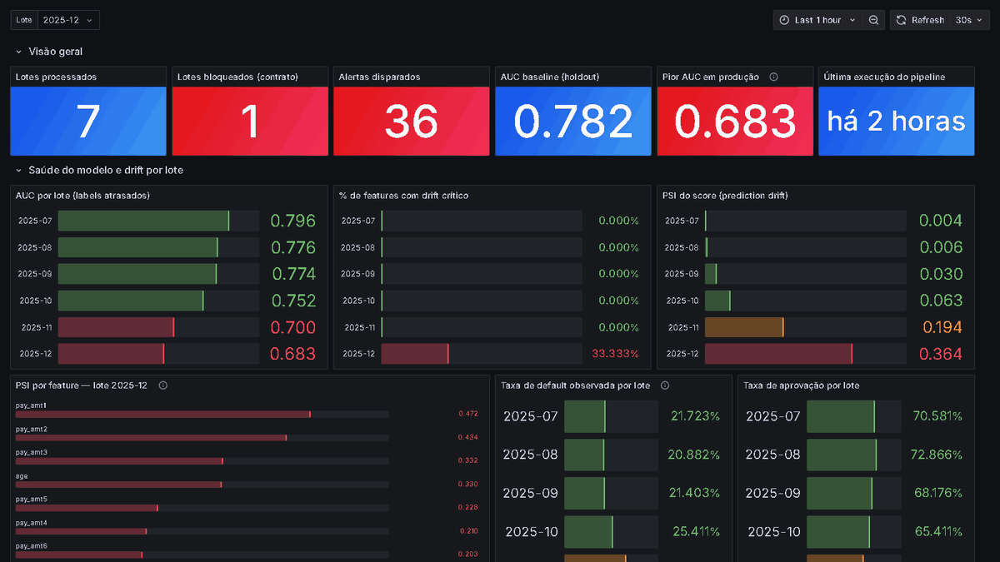
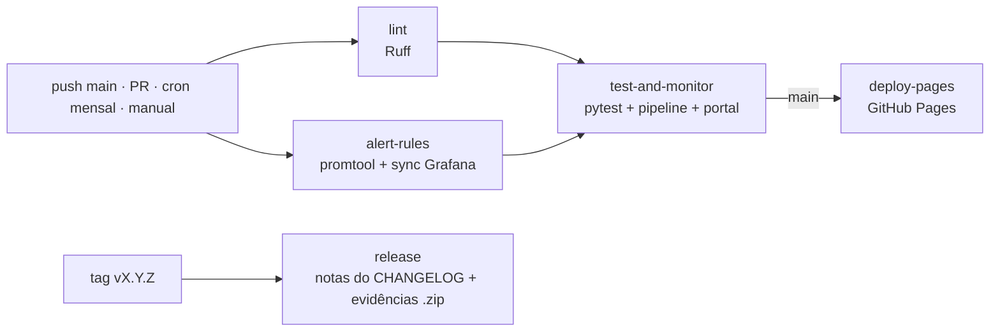
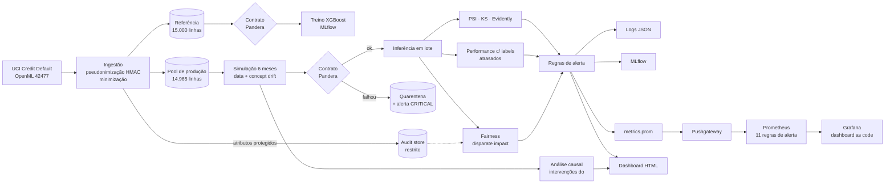
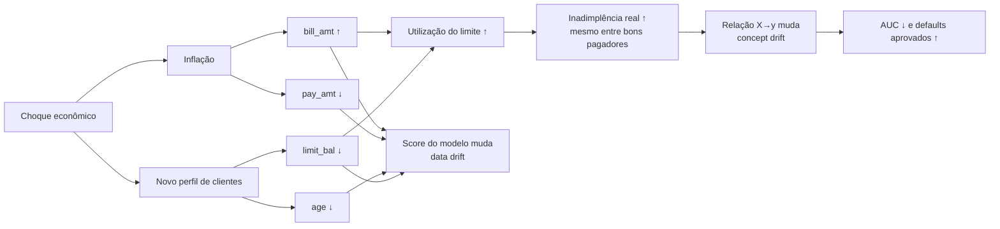

<p align="center">
  
</p>

# SENTRIX

### Continuous ML Observability & Governance for Credit Risk

Projeto desenvolvido para o **Tech Challenge — Fase 4** da Pós-Tech em Machine Learning Engineering da FIAP.

**Autor:** Vitor Diogo Fonseca da Silva — RM375157 (projeto individual)

Plataforma de observabilidade contínua para modelos de Credit Scoring, contemplando validação de dados, detecção de Data Drift e Concept Drift, monitoramento operacional e governança de dados.

Uma fintech de crédito tem um modelo de *credit scoring* em produção. Com inflação e novos perfis de clientes, a diretoria suspeita que ele está degradando em silêncio. Este repositório constrói a **camada de sustentação e confiabilidade** em volta desse modelo:

| Etapa | O que foi feito | Evidência gerada |
|---|---|---|
| 1. Validação de dados | Contrato **Pandera** com 10 regras rígidas, gate que bloqueia e coloca em quarentena lotes ruins | `src/contracts.py`, `data/quarantine/*`, alerta `ingestion_blocked` |
| 2. Drift | Simulação de 6 meses de produção (data drift + concept drift), PSI + KS próprios e relatórios **Evidently AI** | `reports/evidently/drift_report_<mês>.html`, `reports/drift_tables/*.csv` |
| 3. Observabilidade | Logs estruturados JSON, **MLflow** (treino + monitoramento por lote), stack **Pushgateway → Prometheus → Grafana** como código, 11 regras de alerta testadas com `promtool` | `logs/pipeline.jsonl`, `mlflow.db`, `docker-compose.yml`, `monitoring/`, `reports/monitoring_dashboard.html` |
| 4. Governança | Privacy by Design (pseudonimização, minimização, schema estrito), plano LGPD, auditoria de viés, análise causal | este README, `reports/causal_analysis.json` |

> 🎥 **Vídeo STAR (≤ 5 min):** _adicionar link aqui_

🌐 **Portal do projeto:** https://vdfs89.github.io/sentrix-ml/ — dashboard de monitoramento e relatórios Evidently de cada mês, publicados pelo CD

📄 [Model Card](docs/MODEL_CARD.md) · [SPEC — requisitos e rastreabilidade](docs/SPEC.md) · [CHANGELOG](CHANGELOG.md)

---

## Sumário
1. [Interface](#interface)
2. [Como executar](#como-executar)
3. [Arquitetura](#arquitetura)
4. [Dataset e separação Referência × Produção](#dataset-e-separação-referência--produção)
5. [Etapa 1 — Contratos de dados](#etapa-1--validação-de-dados-e-contratos)
6. [Etapa 2 — Simulação e detecção de drift](#etapa-2--simulação-e-detecção-de-drift)
7. [Etapa 3 — Observabilidade](#etapa-3--observabilidade-de-pipelines-e-modelos)
8. [Análise causal da degradação](#análise-causal-da-degradação)
9. [Etapa 4 — Governança e LGPD](#etapa-4--governança-e-lgpd)
10. [Achados técnicos (errata)](#achados-técnicos-errata)
11. [Lições aprendidas](#lições-aprendidas)
12. [Estrutura do repositório](#estrutura-do-repositório)
13. [Versionamento](#versionamento)

---

## Interface

<p align="center">
  
</p>

Dashboard **Grafana** da stack local (`make up`): KPIs, AUC e drift por lote, PSI por feature evoluindo de set/25 a dez/25 pelo seletor de lote, violações do contrato e alertas disparados no Prometheus.

🔗 **Live:** [vdfs89.github.io/sentrix-ml](https://vdfs89.github.io/sentrix-ml/) — portal com o dashboard de monitoramento e os relatórios Evidently

---

## Como executar

Requer Python 3.11.

```bash
python -m venv .venv
# Windows: .venv\Scripts\activate   |   Linux/macOS: source .venv/bin/activate
pip install -r requirements.txt

# (opcional) segredo da pseudonimização — em produção vem de um secret manager
export CREDIT_PII_SALT="um-segredo-forte"

python -m src.pipeline          # ingestão → treino → simulação → monitoramento → relatórios (~30 s)
pytest -q                       # 24 testes: contratos, drift, alertas, métricas, portal, reprodutibilidade

mlflow ui --backend-store-uri sqlite:///mlflow.db   # http://127.0.0.1:5000
```

Depois de rodar, abra **`reports/monitoring_dashboard.html`** no navegador. Etapas isoladas: `python -m src.ingestion`, `python -m src.train`, `python -m src.drift_simulation`, `python -m src.pipeline --monitor`.

### Atalhos (`Makefile` / `make.ps1`)

Os mesmos alvos funcionam com `make <alvo>` (Linux, macOS, WSL e CI) e com `.\make.ps1 <alvo>` (Windows sem make):

| Alvo | O que faz |
|---|---|
| `install` | instala as dependências fixadas (`requirements.txt` + `requirements-dev.txt`) |
| `lint` / `format` | Ruff: checagem de lint e formatação / correção automática |
| `test` | 24 testes (pytest) |
| `pipeline` / `monitor` | pipeline completo / só monitoramento (envia ao Pushgateway se a stack estiver no ar) |
| `findings` | reproduz as evidências da seção Achados técnicos |
| `promtool` | valida e testa as regras de alerta do Prometheus |
| `up` / `down` / `logs` | sobe, derruba e acompanha a stack Docker |
| `push` / `dashboard` | reenvia métricas / regenera o JSON do Grafana |
| `check` | `lint` + `test` + `promtool`: tudo o que o CI checa |
| `site` / `serve` | gera o portal do GitHub Pages em `site/` / gera e serve em http://127.0.0.1:8765 |
| `ci` | `check` + `pipeline` |

### Stack de observabilidade (Docker)

```bash
docker compose up -d                                   # Pushgateway + Prometheus + Grafana
export SENTRIX_PUSHGATEWAY=http://localhost:9091       # PowerShell: $env:SENTRIX_PUSHGATEWAY="http://localhost:9091"
python -m src.pipeline                                 # ou só reenviar o último run: python -m src.push_metrics
```

| Serviço | URL | Observação |
|---|---|---|
| Grafana | http://localhost:3100 | dashboard **SENTRIX** abre como home (acesso anônimo de leitura; admin/`GRAFANA_ADMIN_PASSWORD`) |
| Prometheus | http://localhost:9190 | regras em *Alerts*, 36 alertas após o pipeline |
| Pushgateway | http://localhost:9091 | estado final de cada execução do job batch |

As portas do host fogem de 3000/9090 para a stack rodar ao lado de outros projetos; troque com `SENTRIX_GRAFANA_PORT`, `SENTRIX_PROMETHEUS_PORT` e `SENTRIX_PUSHGATEWAY_PORT`.

```bash
# validar e testar as regras de alerta
docker run --rm -v "$PWD/monitoring/prometheus:/rules" -w /rules --entrypoint promtool prom/prometheus:v2.55.1 test rules alerts_test.yml
```

### CI/CD (GitHub Actions)



| Workflow | Quando | O que faz |
|---|---|---|
| **CI** `ci.yml` › `lint`, `alert-rules`, `test-and-monitor` | push na `main`, pull request, cron mensal (dia 1, 06:00 UTC) e manual | `make lint`; `make promtool` + verificação do JSON do Grafana; depois dos dois, `make test`, `make pipeline` e `make site`, com relatórios e logs publicados como artefato |
| **CD** `ci.yml` › `deploy-pages` | só na `main` (push, cron, manual) | publica o portal no **GitHub Pages**: https://vdfs89.github.io/sentrix-ml/ |
| **CD** `release.yml` | cada tag `vX.Y.Z` | cria a **GitHub Release** com a seção da versão no `CHANGELOG.md` e anexa `reports/`, `logs/` e os metadados do modelo num `.zip` |

O cron mensal simula a operação real: todo mês o pipeline roda do zero, gera os relatórios e republica o portal. O link do vídeo no portal vem da variável `SENTRIX_VIDEO_URL` (Settings › Variables do repositório).

---

## Arquitetura



Cada etapa é instrumentada pelo context manager `stage()` (`src/logging_utils.py`), que emite eventos `started / success / blocked / failed` com `run_id`, `duration_ms` e contexto (lote, linhas, métricas).

---

## Dataset e separação Referência × Produção

* **Dataset:** *Default of Credit Card Clients* (UCI, Taiwan 2005) — 30.000 clientes, classificação binária (`default` no mês seguinte), baixado do OpenML (id 42477). Atende ao requisito de ≥ 5.000 amostras.
* **Limpeza:** colunas `x1..x23` renomeadas para nomes de negócio; códigos não documentados de escolaridade (0, 5, 6) e estado civil (0) mapeados para "outros"; 35 duplicatas removidas.
* **Separação clara** (embaralhamento com seed 42):
  * **Referência** — 15.000 linhas, meses `2025-01..2025-06` (era de treino). Treino 80% / holdout 20%, estratificado.
  * **Produção** — 14.965 linhas divididas em 6 lotes mensais `2025-07..2025-12`, onde o drift é injetado. **O modelo nunca vê esses dados no treino.**
* **Modelo baseline:** XGBoost (300 árvores, profundidade 4), 21 features, sem atributos protegidos. Threshold de decisão **0,23 fixo como política de crédito** (coincide com o ótimo de F1 no holdout, mas não é reotimizado a cada treino; ver [A8](#a8--o-mesmo-modelo-não-é-igual-no-windows-e-no-linux-e-o-threshold-otimizado-mudava-a-política-de-crédito)).

| Métrica no holdout de referência | Valor |
|---|---|
| AUC | **0,782** |
| F1 / Recall / Precision | 0,553 / 0,642 / 0,485 |
| Taxa de aprovação | 70,5% |
| Taxa de default observada | 22,3% |

Features mais importantes: `pay_0` (status do último pagamento, 33%), `pay_2` (19%), `pay_3`, `pay_5`.

---

## Etapa 1 — Validação de dados e contratos

**Foco: lixo não entra no modelo.** O contrato (`src/contracts.py`) é um `DataFrameSchema` Pandera com validação *lazy* (coleta todas as violações de uma vez):

| Regra | Descrição |
|---|---|
| R1 | Sem nulos em features, id e target |
| R2 | Idade entre 18 e 100 (maioridade para crédito) |
| R3 | Limite de crédito > 0 e ≤ 1.000.000 |
| R4 | Escolaridade no domínio fechado {1, 2, 3, 4} |
| R5 | Status de pagamento `pay_*` entre −2 e 8 |
| R6 | `pay_amt*` ≥ 0 e `bill_amt*` entre −1M e 5M |
| R7 | `customer_key` único (sem clientes duplicados) |
| R8 | Target binário {0, 1} |
| R9 | **Schema estrito**: coluna não prevista é rejeitada — um CPF vazado pelo upstream nunca chega ao modelo (*Privacy by Default*) |
| R10 | Lote com ≥ 100 linhas e taxa de default < 80% (sanidade do upstream) |

**Gate de ingestão (`src/validation.py`):** se qualquer regra falhar, **o lote inteiro é bloqueado**, salvo em `data/quarantine/` (dados + `failure_cases.csv` + `validation_report.json`), um log `CRITICAL` com `alert=ingestion_blocked` é emitido e o lote não é pontuado. O próprio dataset de referência passa pelo contrato antes do treino.

**Demonstração:** o pipeline injeta um lote corrompido (`2025-09_upstream_bug`) simulando um bug do fornecedor de dados:

```
[CRITICAL] data_validation  DATA CONTRACT VIOLATED - batch blocked and quarantined
           batch=2025-09_upstream_bug
           failed_rules={'R1': 24, 'R2': 18, 'R3': 8, 'R4': 10, 'R5': 5, 'R6': 7, 'R7': 30, 'R9': 1}
```

Nulos no limite, menores de idade, idade 150, limite negativo, escolaridade inválida, status de pagamento 12, pagamento negativo, 15 clientes duplicados e uma coluna `cpf` vazada — **103 violações em 8 famílias de regras, todas interceptadas.**

---

## Etapa 2 — Simulação e detecção de drift

### Cenário simulado (`src/drift_simulation.py`, `config.DRIFT_SCHEDULE`)

| Mês | Inflação | Novo perfil | Concept flip | Default real |
|---|---|---|---|---|
| 2025-07 | 0% | 0% | 0% | 21,7% |
| 2025-08 | 0% | 0% | 0% | 20,9% |
| 2025-09 | 15% | 10% | 0% | 21,4% |
| 2025-10 | 40% | 20% | 10% | 25,4% |
| 2025-11 | 70% | 30% | 25% | 32,3% |
| 2025-12 | 100% | 40% | 40% | 38,0% |

* **Data drift (≥ 2 variáveis importantes):**
  * *Inflação* → faturas `bill_amt1..6` × (1 + inflação) e pagamentos reais `pay_amt1..6` × (1 − 0,5·inflação).
  * *Novo perfil de cliente* → parte da base vira jovens (21–29 anos, `age`) com limite 60% menor (`limit_bal`).
* **Concept drift:** clientes que *parecem* bons (`pay_0 ≤ 0`, em dia) mas com utilização do limite > 50% passam a inadimplir com probabilidade crescente. `P(default | X)` muda — o modelo continua confiante onde está errado.
* Cada lote original (pré-drift) é guardado em `data/production/original/` para a análise causal.

### Detecção (`src/drift_detection.py`)

Duas camadas complementares, comparando cada lote de produção com a referência:

1. **Testes próprios**, usados pelas regras de alerta:
   * **PSI** com bins por quantis da referência (contínuas) ou por categoria (discretas). < 0,10 estável · 0,10–0,20 moderado (WARNING) · ≥ 0,20 crítico (CRITICAL).
   * **Kolmogorov-Smirnov** (estatística D e p-valor) para as contínuas.
2. **Evidently AI** (`DataDriftPreset` com KS para numéricas e PSI para categóricas + `ClassificationPreset`), gerando um HTML por mês com drift por coluna, drift do score (`prediction`), drift do target e qualidade de classificação vs. referência.

### Resultado

| Lote | AUC | PSI do score | Features PSI ≥ 0,20 | Features PSI 0,10–0,20 | Colunas c/ drift (Evidently, KS) |
|---|---|---|---|---|---|
| 2025-07 | 0,796 | 0,004 | — | — | 1* |
| 2025-08 | 0,776 | 0,006 | — | — | 0 |
| 2025-09 | 0,774 | 0,030 | — | pay_amt4 | 9 |
| 2025-10 | 0,752 | 0,063 | — | — | 15 |
| 2025-11 | **0,700** | 0,194 | — | age, pay_amt1–6, bill_amt1–6 | 15 |
| 2025-12 | **0,683** | **0,364** | **pay_amt1–6, age** | limit_bal, bill_amt1–6 | 16 |

\* falso positivo do KS. Com milhares de linhas, o teste acusa diferenças minúsculas — medido em [Achados técnicos](#achados-técnicos-errata): 36,5% dos lotes **sem drift** têm ao menos um alarme de KS, contra 0% do PSI. Por isso os alertas usam PSI (magnitude) e o KS/Evidently funciona como sinal antecipado.

**Variáveis degradadas apontadas:** `pay_amt1..6` e `age` (críticas), `limit_bal` e `bill_amt1..6` (moderadas) — exatamente as que foram alteradas. As features de status de pagamento (`pay_0..6`), que não foram mexidas, ficaram estáveis: **zero falsos positivos de PSI.**

---

## Etapa 3 — Observabilidade de pipelines e modelos

### O que é coletado

| Camada | Onde | Conteúdo |
|---|---|---|
| **Logs estruturados** | `logs/pipeline.jsonl` | 1 evento JSON por início/fim de etapa: `ts, level, run_id, stage, status, duration_ms, batch, rows, …` + todos os alertas. Pronto para Datadog / Loki / CloudWatch. |
| **MLflow** (`mlflow.db`) | experimento `sentrix-training` | parâmetros, métricas do holdout, hash SHA-256 dos dados de referência, modelo e importâncias (linhagem) |
| | experimento `sentrix-monitoring` | 1 run pai por execução + 1 run filho por lote com todas as métricas, PSI por feature, alertas e o HTML do Evidently; métricas `timeline_*` com `step` = mês para gráficos no UI |
| **Prometheus** | `reports/metrics.prom` → Pushgateway → Prometheus | gauges por lote: `credit_pipeline_batch_validation_passed`, `credit_contract_violations{rule}`, `credit_feature_psi{feature}`, `credit_data_drift_share`, `credit_prediction_psi`, `credit_model_auc`, `credit_model_baseline{metric}`, `credit_observed_default_rate`, `credit_approval_rate`, `credit_disparate_impact`, `credit_model_inference_latency_ms`, `credit_pipeline_last_success_timestamp_seconds` |
| **Grafana** | `monitoring/grafana/` | dashboard provisionado (gerado por `generate_dashboard.py`): KPIs, AUC/drift/score por lote, PSI por feature com seletor de lote, default e aprovação, fairness, latência, violações do contrato por regra e alertas disparados |
| **Dashboard** | `reports/monitoring_dashboard.html` | KPIs, AUC × inadimplência, drift por mês, heatmap PSI feature × mês, decomposição causal, latência/volume, fairness, execuções por etapa (lidas dos logs), tabela de lotes e de alertas com links para cada relatório Evidently |
| **Alertas** | `reports/alerts.json` + logs | 36 alertas na execução de referência (12 críticos, 24 warnings) |

### Regras de alerta no Prometheus

`monitoring/prometheus/alerts.yml` replica as regras do relatório Python — as duas camadas produzem os mesmos **36 alertas**:

| Alerta | Expressão (resumo) | Severidade |
|---|---|---|
| `SentrixDataContractViolation` | `credit_pipeline_batch_validation_passed == 0` | critical |
| `SentrixFeatureDriftWarning` / `Critical` | `credit_feature_psi` ≥ 0,10 / ≥ 0,20 | warning / critical |
| `SentrixDatasetDrift` | `credit_data_drift_share >= 0.30` | critical |
| `SentrixPredictionDriftWarning` / `SentrixPredictionDrift` | `credit_prediction_psi` ≥ 0,10 / ≥ 0,20 | warning / critical |
| `SentrixConceptDrift` | AUC do lote < AUC baseline − 0,05 | critical |
| `SentrixLabelDrift` | \|default observado − referência\| ≥ 0,05 | warning |
| `SentrixFairnessDisparateImpact` | `credit_disparate_impact < 0.80` | warning |
| `SentrixPipelineStale` | última execução há mais de 35 dias | warning |
| `SentrixPushgatewayDown` | `up{job="pushgateway"} == 0` por 1 min | critical |

`alerts_test.yml` tem 7 grupos de teste para o `promtool` com valores reais do pipeline. Ele cobre casos que **devem** disparar, casos que **não** devem (AUC 0,752 fica acima do limite, PSI 0,02 é estável, pipeline com 30 dias) e a janela `for: 1m`. Também foi feito um teste de mutação: subir o limite crítico de PSI para 0,40 faz o `promtool` falhar, o que prova que os testes pegam regressões.

### Métricas de saúde definidas

| Métrica | Tipo | Regra de alerta |
|---|---|---|
| Status do contrato por lote | pipeline | lote bloqueado → **CRITICAL** `data_contract` |
| Volume (linhas por lote) e falhas de validação | pipeline | registrado; lote < 100 linhas viola R10 |
| Duração por etapa (`duration_ms`) e status | pipeline / infra | etapa `failed` vira evento `ERROR` com `error_type` |
| Latência de inferência (ms por lote e por 1k linhas) | infra | registrada (≈ 5 ms / 2.500 linhas) |
| PSI por feature | modelo — data drift | ≥ 0,10 WARNING · ≥ 0,20 CRITICAL |
| % de features com PSI crítico | modelo — dataset drift | ≥ 30% CRITICAL |
| PSI do score (prediction drift) | modelo | ≥ 0,10 WARNING · ≥ 0,20 CRITICAL |
| AUC com labels atrasados | modelo — concept drift | queda ≥ 0,05 vs. baseline → CRITICAL |
| Taxa de default observada | label drift | variação ≥ 5 p.p. → WARNING |
| Disparate impact por sexo | governança | < 0,80 → WARNING |

### Linha do tempo dos alertas

* **2025-09** — bloqueio do lote corrompido (CRITICAL) + primeiro WARNING de PSI.
* **2025-11** — **AUC cai 0,082 (0,782 → 0,700): alerta CRITICAL de concept drift**, mais 13 WARNINGs de PSI, prediction drift moderado (PSI do score 0,19) e label drift de +9,3 p.p.
* **2025-12** — 7 features com drift crítico, 33% do dataset (CRITICAL `dataset_drift`), score com PSI 0,36 (CRITICAL `prediction_drift`) e AUC 0,683.

> O monitoramento de performance (com labels) disparou **um mês antes** do drift crítico de entrada: monitorar só a distribuição de X não basta.

---

## Análise causal da degradação

Monitorar mostra **que** o modelo piorou; a análise causal (`src/causal_analysis.py`) mostra **por quê**. Como a simulação guarda a versão original de cada lote, aplicamos **intervenções do(·)**: restauramos um grupo de variáveis (ou os rótulos) ao valor original, mantendo o resto com drift, e medimos quanto do efeito some.



Resultados (`reports/causal_analysis.json`):

| Mês | Δ PD médio total | devido à inflação | devido ao novo perfil | AUC perdida por data drift | AUC perdida por concept drift | Defaults aprovados pelo modelo (orig. → obs.) |
|---|---|---|---|---|---|---|
| 2025-10 | +0,022 | +0,020 | +0,004 | 0,000 | **0,028** | 196 → 238 |
| 2025-11 | +0,041 | +0,036 | +0,008 | 0,026 | **0,066** | 203 → 336 |
| 2025-12 | +0,056 | +0,050 | +0,010 | 0,023 | **0,080** | 194 → 355 |

**Diagnóstico:**
1. **A mudança no score é causada principalmente pela inflação** (~90% do deslocamento do PD médio); o novo perfil contribui com ~10%.
2. **A perda de capacidade de discriminação é causada principalmente pelo concept drift** (≈ 78% da queda de AUC em dezembro). O modelo não está "vendo dados estranhos": está aplicando uma relação que deixou de valer.
3. **Impacto de negócio:** em dezembro o modelo aprova **355 clientes que inadimplem** contra 194 no cenário sem choque (+83%), enquanto *também* reprova mais (aprovação de 68,9% → 52,6%). Degrada em risco **e** em receita.

**Prescrição:**
* Concept drift não se resolve recalibrando: **retreinar com dados rotulados recentes** (janela deslizante ou ponderada) e incluir variáveis de capacidade de pagamento sensíveis a ciclo econômico (ex.: utilização do limite `bill_amt/limit_bal`, comprometimento de renda).
* Gatilho de retreino: alerta CRITICAL de `concept_drift_performance` **ou** `dataset_drift` por 2 meses seguidos, com aprovação humana (champion/challenger no MLflow antes da promoção).
* Enquanto não retreina: política conservadora temporária (subir o threshold para os segmentos com utilização > 50%) e revisão manual das propostas na fronteira de decisão.

---

## Etapa 4 — Governança e LGPD

### Inventário de dados pessoais e tratamento (Privacy by Design)

| Dado | Classificação | Tratamento no projeto |
|---|---|---|
| `customer_id`, `cpf` | identificadores diretos (sintéticos, gerados para simular a operação real) | **Pseudonimizados** com HMAC-SHA256 + segredo (`CREDIT_PII_SALT`) em `customer_key` e **descartados** na ingestão. Sem o segredo o hash não é revertido nem recalculado por força bruta sobre CPFs. |
| `sex`, `marriage` | dados pessoais com **alto risco de discriminação** | **Nunca usados como feature.** Separados em `data/audit/` (acesso restrito, fora do git), ligados só pelo pseudônimo e usados exclusivamente para auditoria de viés. |
| `age`, `education` | dados pessoais, potenciais *proxies* | Usados como feature (relevância de risco documentada) e monitorados (drift de `age` é alerta). Avaliar remoção na próxima versão — ver vieses abaixo. |
| `limit_bal`, `bill_amt*`, `pay_amt*`, `pay_*` | dados financeiros/comportamentais | Necessários à finalidade (avaliar risco de crédito). Contrato garante domínio e ausência de nulos. |

**Privacy by Default no código:**
* **Minimização (LGPD art. 6º, III):** o modelo recebe só as 21 features listadas em `config.FEATURES`.
* **Schema estrito (R9):** qualquer coluna extra — inclusive um CPF vazado — bloqueia o lote.
* **Segregação:** atributos protegidos vivem em outro armazenamento; dados, banco MLflow e auditoria estão no `.gitignore`.
* **Logs sem PII:** os eventos registram lote, contagens e métricas; nenhum identificador de cliente.
* **Rastreabilidade (art. 37):** cada execução tem `run_id`; o modelo registra hash SHA-256 dos dados de treino, parâmetros e versão no MLflow (linhagem dado → modelo → decisão).

### Base legal para a decisão de crédito

* **Art. 7º, X — proteção do crédito:** base principal para tratar dados financeiros e comportamentais na avaliação de risco.
* **Art. 7º, V — execução de contrato / procedimentos preliminares** a pedido do titular (a proposta de crédito).
* **Não se usa consentimento como base**, porque recusar o tratamento inviabilizaria a análise — consentimento não seria livre.
* **Art. 20 — revisão de decisões automatizadas:** o titular pode pedir revisão da decisão e informações sobre os critérios. Atendemos com (i) importância de features versionada no MLflow, (ii) threshold e versão do modelo registrados por decisão, (iii) fila de revisão humana para contestações.
* **Art. 6º, IX — não discriminação:** atributos protegidos excluídos + monitoramento contínuo de disparate impact.

### Plano de retenção

| Artefato | Retenção | Justificativa / descarte |
|---|---|---|
| Dados brutos com identificadores diretos | não armazenados após a ingestão | pseudonimização imediata (minimização) |
| Base pseudonimizada de referência (treino) | enquanto o modelo treinado com ela estiver em uso + 5 anos | auditoria e reprodutibilidade de decisões; descarte seguro ao fim (art. 16) |
| Lotes de produção e predições | 5 anos após o fim da relação contratual | obrigações legais/regulatórias de guarda de registros de crédito (art. 16, I); após o prazo, eliminação ou anonimização |
| Lotes em quarentena | 90 dias | só para diagnóstico do fornecedor; depois, eliminação |
| Atributos protegidos (audit store) | mesmo prazo da base a que se referem, acesso restrito | só para auditoria de viés |
| Logs operacionais | 1 ano | sem PII; troubleshooting e auditoria |
| Métricas agregadas, relatórios de drift, runs MLflow | indefinido | dados agregados/anonimizados (art. 12) |

Informação negativa de crédito respeita o limite de 5 anos do CDC (art. 43, §1º). O titular pode pedir eliminação; havendo obrigação legal de guarda, os dados ficam bloqueados para outros usos até o fim do prazo.

### Mitigação de vieses

* **Exclusão de atributos protegidos** (sexo, estado civil) das features.
* **Auditoria contínua:** disparate impact (aprovação do grupo menos favorecido ÷ mais favorecido, regra dos 4/5) por lote. Resultado: **0,91–0,98 em todos os meses** (acima de 0,80), sem alerta.
* **Riscos remanescentes documentados:**
  * *Proxies — risco medido:* no holdout, clientes com **50+ anos têm aprovação de 57,5% contra 75,2% na faixa 30–39 (razão 0,76, abaixo de 0,80)**. Parte da diferença acompanha um default real maior (24,7% contra 21,0%), mas `age` é feature e pode atuar como proxy. `age` também sofreu drift (novo público jovem). Ações registradas no [Model Card](docs/MODEL_CARD.md) § 6: monitorar disparate impact por faixa etária, treinar uma variante sem `age` e comparar no MLflow.
  * *Viés histórico do rótulo:* inadimplência passada reflete políticas de crédito passadas (só observamos default de quem foi aprovado — *reject inference*).
  * *Viés de população:* dataset de Taiwan/2005; antes de uso real seria necessário revalidar com a população brasileira.
* **Segurança (art. 46) e incidentes (art. 48):** segredo de pseudonimização em secret manager, acesso mínimo ao audit store, comunicação à ANPD e aos titulares em caso de incidente relevante.
* **RIPD (art. 38):** este README funciona como base do Relatório de Impacto à Proteção de Dados do modelo.

---

## Achados técnicos (errata)

Problemas e surpresas encontrados durante o desenvolvimento, com evidência reproduzível:

```bash
python -m src.technical_findings     # gera reports/technical_findings.json (~1 min)
```

### A1 — O PSI do Evidently não usa quantis, ao contrário do que diz a documentação

A docstring de `get_binned_data` (Evidently 0.7.23) fala em *"buckets based on reference quantiles"*, mas para variáveis numéricas o código usa `np.histogram_bin_edges(..., bins="sturges")`, ou seja, **bins de largura igual sobre o range combinado** de referência + produção. Em variáveis financeiras de cauda longa, quase toda a massa cai no primeiro bin: **98,7% dos valores de `pay_amt1` ficam no 1º de 16 bins**. Resultado: o PSI do Evidently não é só "menos sensível", ele é **inconsistente**:

| Mês | Feature | PSI por quantis (SENTRIX) | PSI Evidently | Leitura |
|---|---|---|---|---|
| 2025-12 | `pay_amt1` (pagamentos −50%) | **0,472** | 0,032 | Evidently **não vê** o drift mais forte do cenário |
| 2025-12 | `bill_amt1` (faturas ×2) | 0,165 | **0,338** | Evidently **superestima**: o range combinado estica e redistribui a cauda |
| 2025-12 | `limit_bal` | 0,184 | 0,138 | próximos |
| 2025-11 | `pay_amt1` | 0,153 | 0,013 | idem |

**Decisão:** os alertas usam o PSI próprio (bins por quantis da referência, padrão de mercado em risco de crédito). No relatório Evidently usamos **KS** para as numéricas e PSI só para as categóricas, onde o binning é por categoria e está correto.

### A2 — KS em amostras grandes gera falso positivo; PSI não

Experimento sob a hipótese nula: 200 sorteios de 2.495 linhas da própria referência contra o restante dela (não existe drift nenhum), testando as 14 features numéricas:

| Teste | Falso positivo por feature | Lotes sem drift com ≥ 1 alarme |
|---|---|---|
| KS (p < 0,05) | 5,4% (≈ α nominal) | **36,5%** |
| PSI (≥ 0,10) | 0,0% | **0,0%** |

O KS se comporta como prometido (≈ 5% por teste), mas com 14 testes por lote o alarme falso vira rotina (efeito de comparações múltiplas). No pipeline real isso apareceu duas vezes: `bill_amt4` em 2025-08 (nosso KS) e uma coluna em 2025-07 (KS do Evidently), ambos meses sem drift.

### A3 — Trade-off medido: KS detecta antes, PSI não erra

Comparando com o gabarito da simulação (`data/production/drift_manifest.json`):

| Mês | Features alteradas | PSI ≥ 0,10: precisão / recall | KS p < 0,05: precisão / recall |
|---|---|---|---|
| 2025-08 | 0 | — (nenhum alarme) | 1 falso positivo |
| 2025-09 | 14 | 100% / 7% | 100% / 100% |
| 2025-10 | 14 | — / 0% | 100% / 100% |
| 2025-11 | 14 | 100% / 93% | 100% / 100% |
| 2025-12 | 14 | 100% / 100% | 100% / 100% |

O KS percebe o choque **dois meses antes**, mas ao preço do ruído medido em A2. O PSI só alarma quando a mudança já é material. **Recomendação para a v2:** KS como sinal *informativo* (dashboard, sem página ao plantão), com correção de Bonferroni/Benjamini-Hochberg, e PSI como gatilho de alerta.

### A4 — Monitorar só X chega tarde

Primeiro mês de cada alerta (`reports/technical_findings.json › F4`): `concept_drift_performance` CRITICAL em **2025-11**, um mês antes de `feature_drift_psi` CRITICAL e `dataset_drift` (2025-12). A queda de AUC com labels atrasados foi o sinal mais precoce entre os críticos.

### A5 — pandas 3 quebra Evidently 0.7 e o parser ARFF do scikit-learn

Com `pandas>=3`, `import evidently` falha (`ImportError: cannot import name 'infer_dtype_from_object'`) e `fetch_openml` quebra ao renomear categorias. Fixamos `pandas==2.3.3` e todas as dependências em versões exatas (`requirements.txt`).

### A6 — Conflito de portas com a stack da Fase 3

Prometheus e Grafana da Fase 3 já ocupavam 9090/3000. A stack SENTRIX usa 9190/3100 por padrão (configuráveis), para as duas rodarem lado a lado.

### A7 — Pushgateway perde tudo quando o Docker reinicia

Uma atualização do Docker Desktop reiniciou o engine e o Pushgateway voltou com **0 métricas**: por padrão ele guarda tudo em memória, então o painel ficaria vazio até a próxima execução do pipeline. A correção foi `--persistence.file` em um volume. Na primeira tentativa, o volume montado em `/data` deu `permission denied`, porque o processo roda como `nobody` e o volume pertencia ao root. A versão final monta em `/pushgateway`, diretório que já é do `nobody` na imagem. Validado: 196 métricas presentes depois de `docker compose restart pushgateway`.

### A8 — O mesmo modelo não é igual no Windows e no Linux, e o threshold "otimizado" mudava a política de crédito

O primeiro deploy do portal mostrou AUCs um pouco diferentes das do README: dez/25 deu 0,688 no CI e 0,683 local. A investigação, passo a passo:

1. **Os dados são idênticos:** as mesmas linhas, o mesmo hash da referência e o PSI de todas as features igual até a última casa. A ingestão e a simulação são determinísticas.
2. **O modelo não é:** treinando o XGBoost 3.2.0 com os mesmos dados e a mesma seed, 1, 4 e todas as threads geram três modelos diferentes na mesma máquina. Mesmo com `n_jobs=1`, Windows e Linux divergem (PD médio no holdout de 0,22184 contra 0,22250), por causa do compilador e das instruções SIMD de cada build. **Reprodutibilidade bit a bit entre plataformas não é alcançável** com essa biblioteca.
3. **O efeito na operação:**
   * o PSI do score de nov/25 foi de 0,194 para 0,204 e **cruzou o limite de 0,20**, e o alerta de prediction drift virou CRITICAL em vez de WARNING;
   * mais grave: o threshold escolhido como ótimo de F1 num grid de 0,01 saltou de **0,23 para 0,26**, porque a curva de F1 é achatada perto do máximo, e **a taxa de aprovação subiu de 3,7 a 6,9 p.p.** em todos os meses. Em crédito, isso é a política de concessão mudando sozinha a cada retreino.

**Correções:**
* O threshold virou **parâmetro de política versionado** (`config.DECISION_THRESHOLD = 0.23`). O ótimo por F1 continua sendo calculado e registrado no MLflow (`f1_optimal_threshold`), só para revisão humana.
* `src/reproducibility.py` roda no CI e compara a execução com a evidência versionada:
  * dados e PSI precisam bater exatamente;
  * AUC (±0,01), PSI do score (±0,02), aprovação (±3 p.p.) e PD médio (±0,01) precisam ficar dentro da tolerância;
  * um alerta dependente do modelo que mude de severidade na fronteira é reportado, mas não reprova.
* O portal publica a **evidência versionada**, com os mesmos números do README. A execução do CI fica como artefato (`reproducibility.txt`).

**Lição:** o alerta e a decisão de negócio precisam ser robustos ao ruído numérico do modelo. Para alertas, isso significa histerese ou banda de tolerância perto dos limites. Para a decisão, um threshold definido pela política de crédito, e não pelo argmax de uma métrica.

---

## Lições aprendidas

1. **Drift de entrada não basta.** O alerta mais valioso (AUC −0,08 em 2025-11) veio da performance com labels, um mês antes de o PSI ficar crítico.
2. **Toda métrica de drift tem um viés de implementação.** O PSI do Evidently usa bins de largura igual e não enxerga `pay_amt1` caindo pela metade (A1). O KS dispara em 36,5% dos lotes sem drift (A2). Validar o detector contra um gabarito é tão importante quanto validar o modelo.
3. **Contrato de dados é a primeira linha de defesa**, inclusive de privacidade: o schema estrito impede que PII chegue ao modelo.
4. **Causalidade muda a resposta.** Data drift pede recalibração; concept drift pede retreino com dados novos. Saber qual domina evita a correção errada.
5. **Observabilidade precisa de um formato comum.** Logs JSON + MLflow + Prometheus a partir dos mesmos registros deixam qualquer ferramenta (Grafana, Datadog) consumir sem retrabalho.

---

## Estrutura do repositório

```
├── src/
│   ├── config.py            # caminhos, features, thresholds, cenário de drift
│   ├── ingestion.py         # download, limpeza, pseudonimização, split referência/produção
│   ├── contracts.py         # contrato Pandera (R1–R10)
│   ├── validation.py        # gate de ingestão, quarentena, lote corrompido de demonstração
│   ├── train.py             # XGBoost baseline + MLflow
│   ├── drift_simulation.py  # inflação, novo perfil, concept drift
│   ├── drift_detection.py   # PSI, KS, relatórios Evidently
│   ├── fairness.py          # disparate impact
│   ├── causal_analysis.py   # intervenções do(·) e decomposição da degradação
│   ├── monitoring.py        # MLflow, regras de alerta, Prometheus
│   ├── dashboard.py         # dashboard HTML (Plotly)
│   ├── logging_utils.py     # logs JSON estruturados
│   ├── push_metrics.py      # reenvia o último run ao Pushgateway
│   ├── portal.py            # portal HTML do GitHub Pages
│   ├── technical_findings.py # evidências da seção Achados técnicos
│   └── pipeline.py          # orquestração ponta a ponta
├── tests/                   # pytest
├── reports/                 # dashboard, Evidently, drift tables, alertas, métricas
├── models/                  # modelo + metadados (versão, hash dos dados, métricas)
├── logs/pipeline.jsonl      # logs estruturados
├── monitoring/
│   ├── prometheus/          # prometheus.yml, alerts.yml (11 regras), alerts_test.yml (promtool)
│   └── grafana/             # provisioning, dashboards/sentrix.json, generate_dashboard.py
├── docker-compose.yml       # Pushgateway + Prometheus + Grafana
├── site/ (gerado)           # portal do GitHub Pages (python -m src.portal)
├── Makefile · make.ps1      # atalhos (Linux/CI · Windows)
├── pyproject.toml           # configuração do Ruff e do pytest
├── docs/                    # MODEL_CARD.md, SPEC.md, capa e GIF
├── CHANGELOG.md
└── .github/workflows/        # ci.yml (CI + deploy Pages), release.yml (releases por tag)
```

## Versionamento

| O quê | Versão | Onde |
|---|---|---|
| Projeto SENTRIX | **1.5.0** ([SemVer](https://semver.org/lang/pt-BR/)) | tags git `v1.0.0` … `v1.5.0` e [Releases](https://github.com/vdfs89/sentrix-ml/releases) · `pyproject.toml` · `src/__init__.py` · [`CHANGELOG.md`](CHANGELOG.md) |
| Modelo `credit-scoring-xgb` | 1.0.0 | `models/model_metadata.json` + MLflow (com hash SHA-256 dos dados de treino) |
| Contrato de dados | `credit_scoring_input_contract_v1` | `src/contracts.py` |
| Python | 3.11 | CI e ambiente local |
| Dependências Python | versões exatas | `requirements.txt` (pandas 2.3.3, scikit-learn 1.9.1, XGBoost 3.2.0, Pandera 0.36.0, Evidently 0.7.23, MLflow 3.18.0, prometheus-client 0.26.0…) · `requirements-dev.txt` (Ruff 0.17.6) |
| Imagens Docker | tags fixas | Prometheus v2.55.1 · Pushgateway v1.9.0 · Grafana 11.3.0 |

Projeto, modelo e contrato têm versões independentes: mudar o dashboard não muda o modelo, e retreinar o modelo não muda o contrato.
